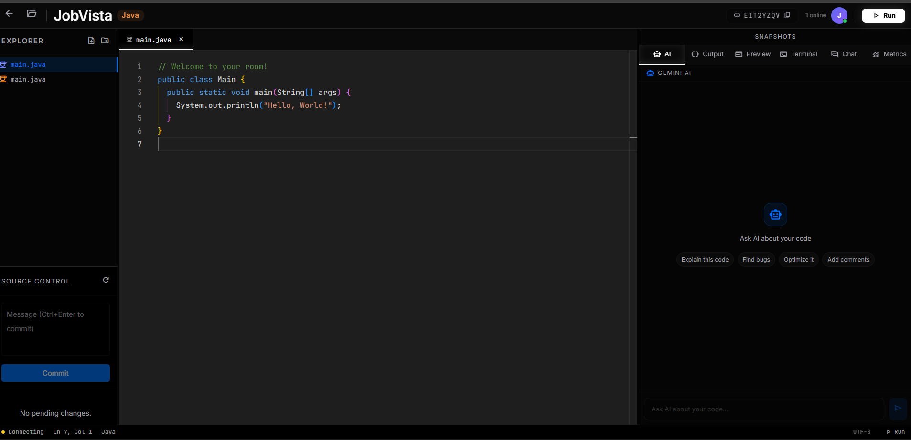
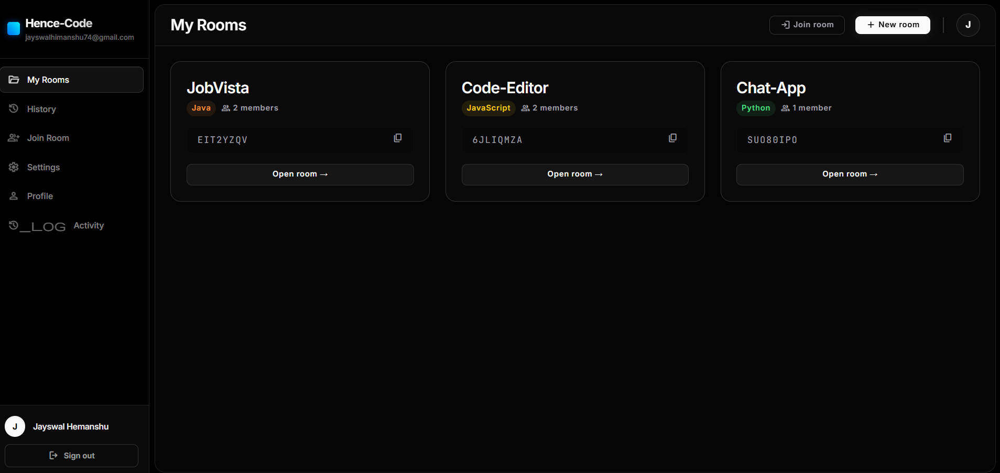
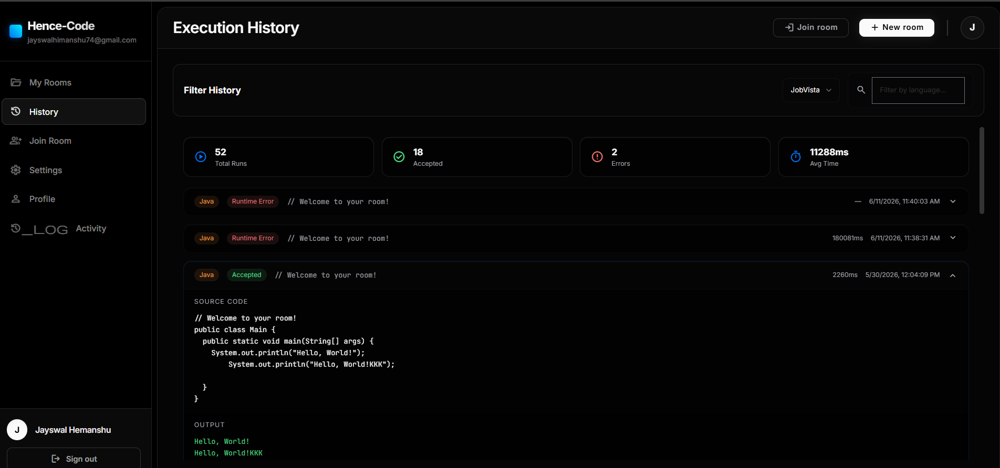
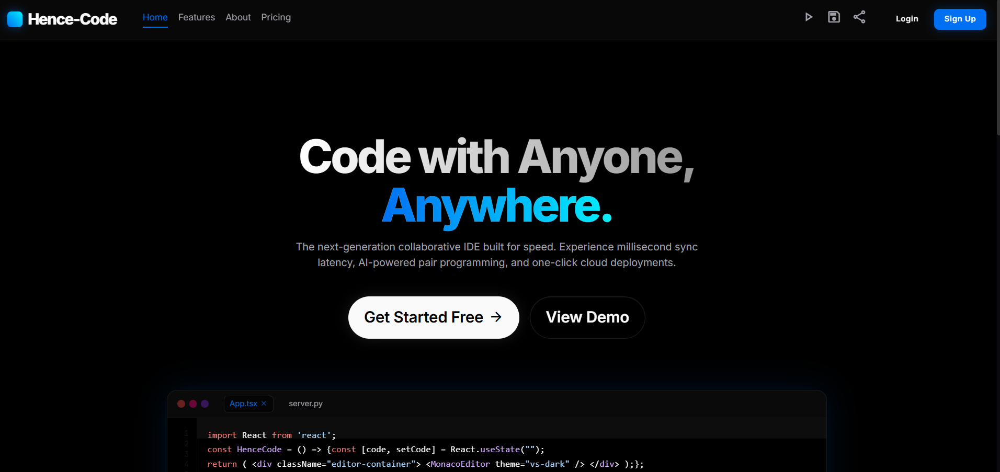
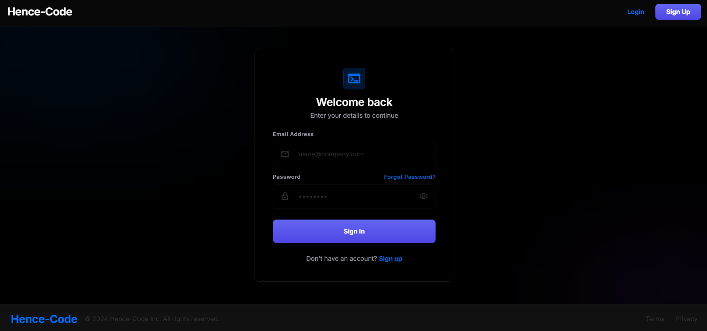
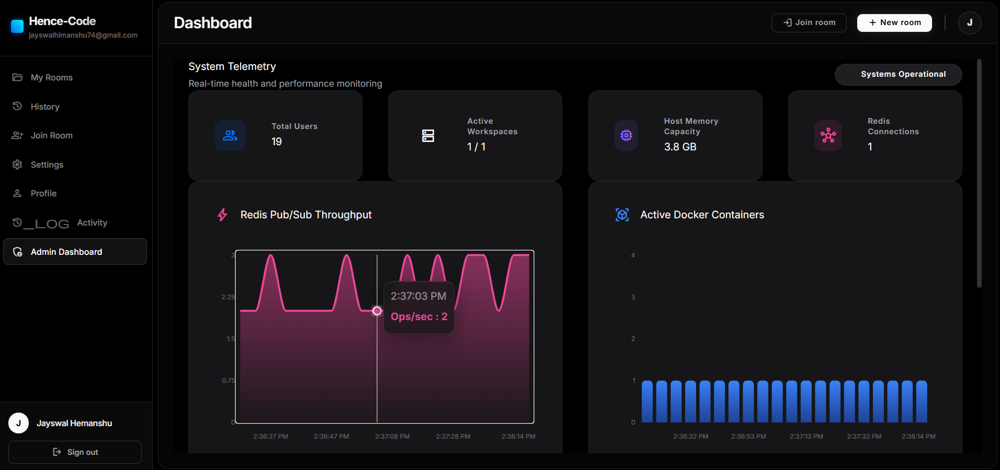
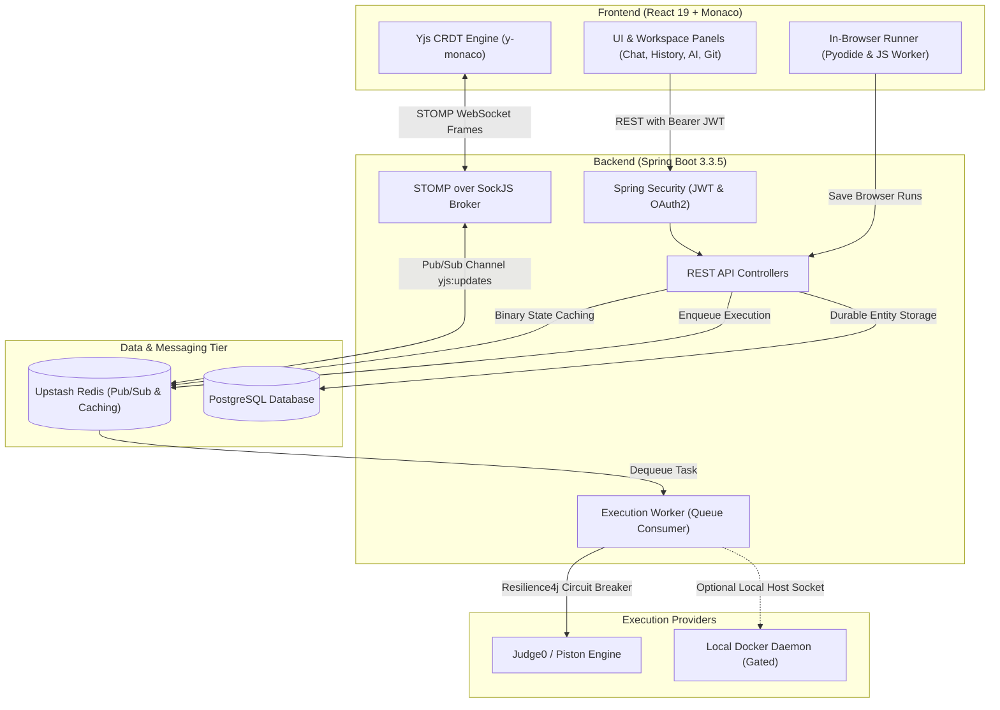
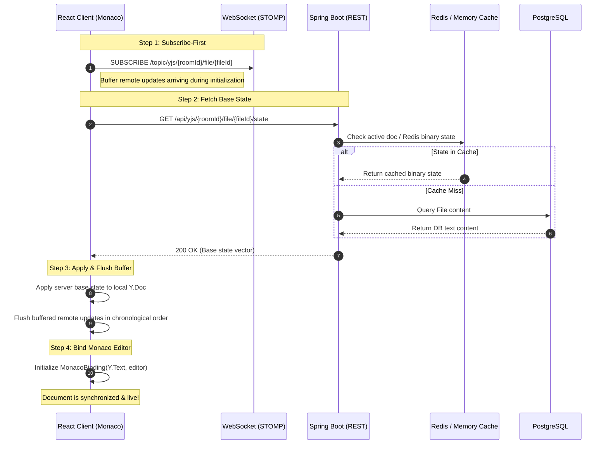

<h1 align="center">Hence-Code</h1>

<p align="center">
  <strong>A distributed, real-time collaborative code editor and multi-language execution platform.</strong>
</p>

<p align="center">
  <a href="https://spring.io/projects/spring-boot"></a>
  <a href="https://react.dev"></a>
  <a href="https://microsoft.github.io/monaco-editor/"></a>
  <a href="https://www.postgresql.org"></a>
  <a href="https://upstash.com"></a>
  <a href="https://github.com/yjs/yjs"></a>
  <a href="LICENSE"></a>
</p>

<p align="center">
  <!-- TODO: Replace with your actual live deployment link -->
  <a href="https://code-editor-git-main-jayswalhimanshu74-4107s-projects.vercel.app/"><strong>🌐 Live Demo: https://code-editor-git-main-jayswalhimanshu74-4107s-projects.vercel.app/</strong></a>
</p>

---

## 📽️ Demo & Screenshots

> Placeholder for demo walkthrough: `docs/demo.gif` <!-- TODO: Add docs/demo.gif recorded walkthrough -->

### Collaborative Workspace & Monaco Editor
<p align="center">
  
</p>

### Main Dashboard & Execution History
<p align="center">
  
  
</p>

### Authentication & Admin Analytics
<p align="center">
  
  
  
</p>

---

## ✨ Features

* **Real-Time Collaboration**: Google Docs-style concurrent editing powered by **Monaco Editor**, **Yjs CRDTs**, and `y-monaco` with live peer cursor awareness and participant colors.
* **Deterministic Synchronization**: Robust 4-step document load sequence (subscribe first $\rightarrow$ fetch base state $\rightarrow$ flush buffered updates $\rightarrow$ bind Monaco) eliminating synchronization race conditions.
* **Multi-Tier State Resolution**: 3-tier document persistence combining active in-memory documents, Upstash Redis binary state dumps, and PostgreSQL database persistence with $5000\text{ms}$ debounced saves.
* **Hybrid Code Execution Engine**:
  * **In-Browser Execution (Zero Server Cost)**: Sandboxed Web Workers inside isolated iframes (`sandbox="allow-scripts"` only) for JavaScript and official Pyodide WebAssembly for Python, executing with client timeouts ($5\text{s}$ for JS, $10\text{s}$ for Python).
  * **Server-Side Execution**: Compiled languages (Java, C++, Go, Rust, etc.) routed asynchronously through Redis queues to Judge0 / Piston APIs protected by Resilience4j Circuit Breakers, Retries, and Bulkheads.
* **Comprehensive Execution History**: Persistent audit log of code runs across all workspaces, grouped under date headers (`Today`, `Yesterday`, `MMM d`), displaying real durations, exit codes, stdout, stderr, and non-clipping full-height view.
* **Workspaces & Invite System**: Create instant workspaces with custom starter code, share invite codes, and join collaborator rooms seamlessly.
* **File Tree Management**: Nested directory and file CRUD operations with active file tabs.
* **Workspace Snapshots**: Create tagged point-in-time file snapshots and restore previous revisions.
* **In-Room Real-Time Chat**: Integrated chat panel over STOMP WebSockets for instant peer communication.
* **AI Coding Assistant Panel**: Contextual code explanation, refactoring, code review, and interactive chat assistant.
* **Source Control Panel**: Integrated Git-style staging, commit history, and branch status.
* **Cold-Start Resilience**: Lightweight `/health` warm-up ping and an automatic non-blocking retry banner that cushions Render free-tier cold starts ($30\text{--}60\text{s}$).

---

## 🏗️ Architecture



### Sequence Diagram: Opening a Collaborative File



---

## 🛠️ Tech Stack

| Layer | Technologies | Purpose |
| :--- | :--- | :--- |
| **Frontend** | React 19, Monaco Editor (`@monaco-editor/react`), `y-monaco`, Yjs, Zustand, Axios, Tailwind CSS | Browser IDE interface, CRDT collaboration, local state management |
| **Browser Execution** | Pyodide (v0.26.4 WebAssembly), Web Workers inside sandboxed iframes | Zero-cost, isolated client-side execution for Python and JavaScript |
| **Backend** | Java 21 / 22, Spring Boot 3.3.5, Spring Security, Spring Data JPA, Spring WebSocket (SockJS + STOMP) | REST APIs, STOMP messaging, authentication, and execution routing |
| **Data & Cache** | PostgreSQL 16, Redis (Upstash) with Lettuce connection pooling | Relational entities, binary Yjs document state cache, Redis Pub/Sub, rate limiting |
| **Remote Execution** | Judge0 API, Piston API, Resilience4j (CircuitBreaker, Retry, Bulkhead) | Sandboxed server-side execution for compiled languages |
| **Deployment** | Vercel (Frontend), Render Free Tier (Backend), Neon (PostgreSQL), Upstash (Redis) | Cloud hosting across free infrastructure tiers |

---

## 🚀 Getting Started

### Prerequisites

* **Java JDK 21 or 22**
* **Node.js 18+ or 20+** and `npm`
* **PostgreSQL** (running locally on port `5432` or cloud instance)
* **Redis** (running locally on port `6379` or Upstash instance)
* **Docker Desktop** *(optional, only required if running local containerized terminals)*

### 1. Clone Repository

```bash
git clone https://github.com/your-username/Hence-Code.git
cd Hence-Code
```

### 2. Backend Setup

```bash
cd Code-Editor_backend

# Copy the example environment template (variable names only)
cp .env.example .env

# Configure your database and Redis properties in application-local.properties or via environment variables
mvn spring-boot:run -Dspring-boot.run.profiles=local
```
*The Spring Boot backend will start on `http://localhost:8080`.*

### 3. Frontend Setup

```bash
cd ../frontend

# Copy the example environment template
cp .env.example .env

# Install dependencies and start development server
npm install
npm run dev
```
*The React application will be available at `http://localhost:5173`.*

### Environment Variables Template

#### Frontend (`frontend/.env.example`)
* `VITE_API_URL`
* `VITE_WS_URL`
* `VITE_CLIENT_RUN`
* `VITE_DOCKER_FEATURES`

#### Backend (`Code-Editor_backend/.env.example`)
* `PORT`
* `FRONTEND_URL`
* `SPRING_PROFILES_ACTIVE`
* `SPRING_DATASOURCE_URL`
* `SPRING_DATASOURCE_USERNAME`
* `SPRING_DATASOURCE_PASSWORD`
* `SPRING_DATA_REDIS_HOST`
* `SPRING_DATA_REDIS_PORT`
* `SPRING_DATA_REDIS_PASSWORD`
* `JWT_SECRET`
* `JWT_ACCESS_EXPIRATION_MS`
* `JWT_REFRESH_EXPIRATION_MS`
* `SPRING_SECURITY_OAUTH2_CLIENT_REGISTRATION_GOOGLE_CLIENT_ID`
* `SPRING_SECURITY_OAUTH2_CLIENT_REGISTRATION_GOOGLE_CLIENT_SECRET`
* `SPRING_SECURITY_OAUTH2_CLIENT_REGISTRATION_GITHUB_CLIENT_ID`
* `SPRING_SECURITY_OAUTH2_CLIENT_REGISTRATION_GITHUB_CLIENT_SECRET`
* `EXECUTION_PROVIDER`
* `EXECUTION_JUDGE0_URL`
* `EXECUTION_JUDGE0_KEY`
* `EXECUTION_JUDGE0_HOST`
* `EXECUTION_PISTON_URL`
* `AI_GEMINI_API_KEY`
* `OPENAI_API_KEY`
* `ADMIN_BOOTSTRAP_ENABLED`
* `ADMIN_BOOTSTRAP_SECRET`
* `GITHUB_TOKEN_ENCRYPTION_KEY`

---

## 💡 Key Design Decisions

1. **Why Yjs & CRDTs over Operational Transformation (OT)**:
   CRDTs ensure strong eventual consistency across decentralized or multi-node environments without requiring a single centralized master lock to order every keystroke. Conflicts resolve deterministically on every peer.
2. **Subscribe-First, Fetch, Flush, Bind Sequence**:
   Opening a file by fetching state before subscribing creates a race condition where edits made during the roundtrip are lost. Subscribing first and buffering incoming updates ensures that when the base snapshot arrives, all concurrent updates are cleanly applied in order before binding Monaco.
3. **3-Tier State Resolution with Debounced Persistence**:
   Hitting PostgreSQL on every character typed would saturate the database connection pool. Instead:
   * Active rooms maintain document state in fast server memory.
   * Updates are mirrored into an Upstash Redis binary cache and broadcast via Redis Pub/Sub.
   * Full document snapshots are saved to PostgreSQL with a $5000\text{ms}$ debounce window and on room unload.
4. **Client-Driven Persistence for Browser Runs**:
   To minimize cloud execution costs, Python (Pyodide) and JavaScript execute directly inside the user's browser. Rather than skipping history, the frontend records completed browser runs back to the backend `POST /api/rooms/{roomId}/executions` endpoint, maintaining a unified execution audit log.

---

## ⚠️ Known Limitations

* **Render Free-Tier Cold Starts**: On free cloud tiers, the backend container hibernates after 15 minutes of inactivity. Initial requests can take 30–60 seconds to respond. The frontend includes an automatic warm-up ping and non-blocking retry banner to manage this.
* **15-Minute Access Tokens**: JWT access tokens expire after 15 minutes and automatically refresh via HttpOnly refresh token cookies. WebSocket connections reconnect automatically upon token refresh.
* **Client-Driven Persistence for Browser Execution**: If a user's network disconnects during a browser-side execution, the run will display locally but may fail to persist to the central execution history table.
* **Cloud Docker Gating**: The interactive container terminal requires a live Docker daemon socket. On cloud tiers (Render / Vercel), terminal features are cleanly gated via `VITE_DOCKER_FEATURES=false`.

---

## 🗺️ Roadmap

1. **Language Server Protocol (LSP)**: Add containerized or WebAssembly-based language servers for advanced autocompletion, hover documentation, and jump-to-definition.
2. **Kubernetes Sandbox Runner**: Transition remote execution from third-party APIs to ephemeral isolated Kubernetes Pods.
3. **Cloud Object Storage**: Offload large workspace snapshots and zip exports to S3/Cloudflare R2 buckets.
4. **WebRTC Voice & Video**: Direct peer-to-peer audio and video channels between room collaborators.

---


### Prerequisites

* **Java JDK 21 or 22**
* **Node.js 18+ or 20+** and `npm`
* **PostgreSQL** (running locally on port `5432` or cloud instance)
* **Redis** (running locally on port `6379` or Upstash instance)
* **Docker Desktop** *(optional, only required if running local containerized terminals)*

### 1. Clone Repository

```bash
git clone https://github.com/your-username/Hence-Code.git
cd Hence-Code
```

### 2. Backend Setup

```bash
cd Code-Editor_backend

# Copy the example environment template (variable names only)
cp .env.example .env

# Configure your database and Redis properties in application-local.properties or via environment variables
mvn spring-boot:run -Dspring-boot.run.profiles=local
```
*The Spring Boot backend will start on `http://localhost:8080`.*

### 3. Frontend Setup

```bash
cd ../frontend

# Copy the example environment template
cp .env.example .env

# Install dependencies and start development server
npm install
npm run dev
```
*The React application will be available at `http://localhost:5173`.*

### Environment Variables Template

#### Frontend (`frontend/.env.example`)
* `VITE_API_URL`
* `VITE_WS_URL`
* `VITE_CLIENT_RUN`
* `VITE_DOCKER_FEATURES`

#### Backend (`Code-Editor_backend/.env.example`)
* `PORT`
* `FRONTEND_URL`
* `SPRING_PROFILES_ACTIVE`
* `SPRING_DATASOURCE_URL`
* `SPRING_DATASOURCE_USERNAME`
* `SPRING_DATASOURCE_PASSWORD`
* `SPRING_DATA_REDIS_HOST`
* `SPRING_DATA_REDIS_PORT`
* `SPRING_DATA_REDIS_PASSWORD`
* `JWT_SECRET`
* `JWT_ACCESS_EXPIRATION_MS`
* `JWT_REFRESH_EXPIRATION_MS`
* `SPRING_SECURITY_OAUTH2_CLIENT_REGISTRATION_GOOGLE_CLIENT_ID`
* `SPRING_SECURITY_OAUTH2_CLIENT_REGISTRATION_GOOGLE_CLIENT_SECRET`
* `SPRING_SECURITY_OAUTH2_CLIENT_REGISTRATION_GITHUB_CLIENT_ID`
* `SPRING_SECURITY_OAUTH2_CLIENT_REGISTRATION_GITHUB_CLIENT_SECRET`
* `EXECUTION_PROVIDER`
* `EXECUTION_JUDGE0_URL`
* `EXECUTION_JUDGE0_KEY`
* `EXECUTION_JUDGE0_HOST`
* `EXECUTION_PISTON_URL`
* `AI_GEMINI_API_KEY`
* `OPENAI_API_KEY`
* `ADMIN_BOOTSTRAP_ENABLED`
* `ADMIN_BOOTSTRAP_SECRET`
* `GITHUB_TOKEN_ENCRYPTION_KEY`

---

## 💡 Key Design Decisions

1. **Why Yjs & CRDTs over Operational Transformation (OT)**:
   CRDTs ensure strong eventual consistency across decentralized or multi-node environments without requiring a single centralized master lock to order every keystroke. Conflicts resolve deterministically on every peer.
2. **Subscribe-First, Fetch, Flush, Bind Sequence**:
   Opening a file by fetching state before subscribing creates a race condition where edits made during the roundtrip are lost. Subscribing first and buffering incoming updates ensures that when the base snapshot arrives, all concurrent updates are cleanly applied in order before binding Monaco.
3. **3-Tier State Resolution with Debounced Persistence**:
   Hitting PostgreSQL on every character typed would saturate the database connection pool. Instead:
   * Active rooms maintain document state in fast server memory.
   * Updates are mirrored into an Upstash Redis binary cache and broadcast via Redis Pub/Sub.
   * Full document snapshots are saved to PostgreSQL with a $5000\text{ms}$ debounce window and on room unload.
4. **Client-Driven Persistence for Browser Runs**:
   To minimize cloud execution costs, Python (Pyodide) and JavaScript execute directly inside the user's browser. Rather than skipping history, the frontend records completed browser runs back to the backend `POST /api/rooms/{roomId}/executions` endpoint, maintaining a unified execution audit log.

---

## ⚠️ Known Limitations

* **Render Free-Tier Cold Starts**: On free cloud tiers, the backend container hibernates after 15 minutes of inactivity. Initial requests can take 30–60 seconds to respond. The frontend includes an automatic warm-up ping and non-blocking retry banner to manage this.
* **15-Minute Access Tokens**: JWT access tokens expire after 15 minutes and automatically refresh via HttpOnly refresh token cookies. WebSocket connections reconnect automatically upon token refresh.
* **Client-Driven Persistence for Browser Execution**: If a user's network disconnects during a browser-side execution, the run will display locally but may fail to persist to the central execution history table.
* **Cloud Docker Gating**: The interactive container terminal requires a live Docker daemon socket. On cloud tiers (Render / Vercel), terminal features are cleanly gated via `VITE_DOCKER_FEATURES=false`.

---

## 🗺️ Roadmap

1. **Language Server Protocol (LSP)**: Add containerized or WebAssembly-based language servers for advanced autocompletion, hover documentation, and jump-to-definition.
2. **Kubernetes Sandbox Runner**: Transition remote execution from third-party APIs to ephemeral isolated Kubernetes Pods.
3. **Cloud Object Storage**: Offload large workspace snapshots and zip exports to S3/Cloudflare R2 buckets.
4. **WebRTC Voice & Video**: Direct peer-to-peer audio and video channels between room collaborators.

---

## 👤 Author

<!-- TODO: Update with your personal links -->
* **Author**: Himanshu Jayswal
* **GitHub**: [@jayswalhimanshu74-cmd](https://github.com/jayswalhimanshu74-cmd)
* **LinkedIn**: [linkedin.com/in/himanshu-jayswal-dev](www.linkedin.com/in/himanshu-jayswal-dev)
* **Portfolio**: [yourportfolio.dev](https://yourportfolio.dev)

---

## 📄 License

This project is licensed under the MIT License - see the [LICENSE](LICENSE) file for details.
